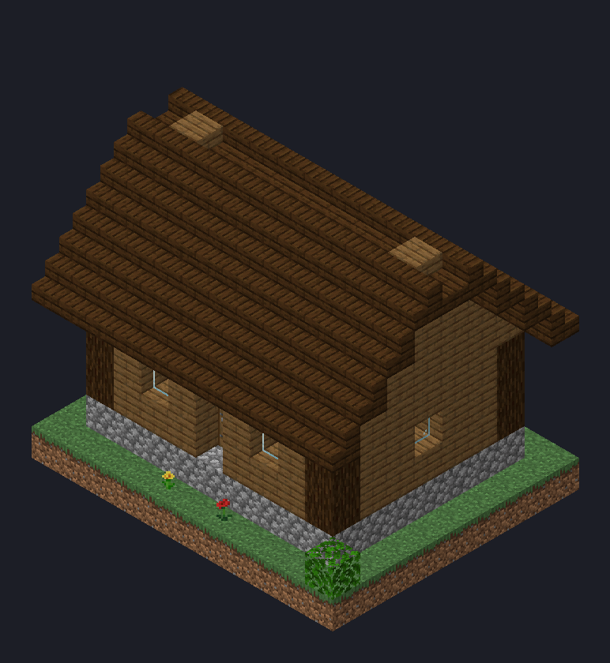
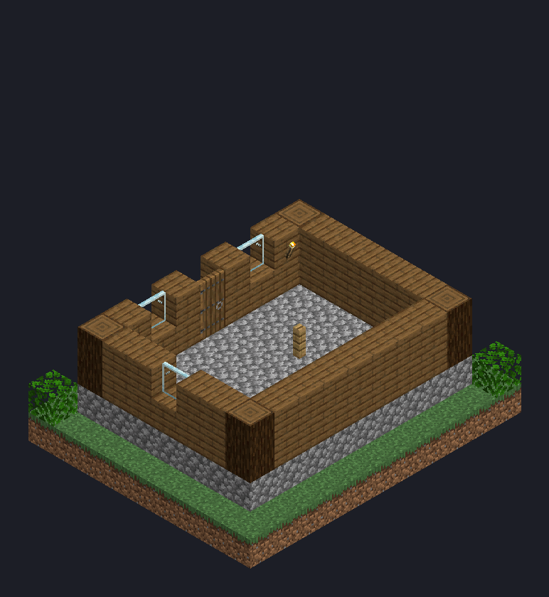
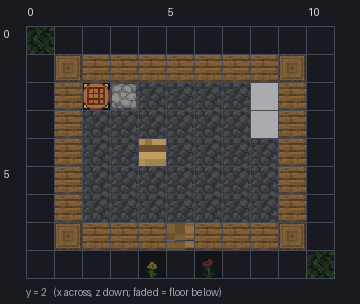
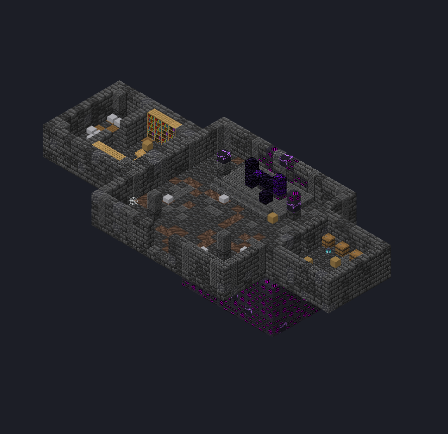

# minecraft-structure-mcp

**Let an AI assistant design Minecraft structures.** An [MCP](https://modelcontextprotocol.io) server for Claude
(and any other MCP client) that builds structure-block `.nbt` files: place and fill blocks, read layers back as
text, *look at the result* as isometric renders drawn with the game's own models and textures, and save a file
you can load in game or ship in a mod or datapack.

No game needs to be running, and no Minecraft assets are shipped: models and textures are read from **your own**
Minecraft client jar.

| Isometric render | Cut-away (`cut_y`) | Layer plan |
|---|---|---|
|  |  |  |

It handles modded blocks too (point it at a mod's assets). This underground ruin with hidden rooms, made for the
[Araz](https://www.curseforge.com/minecraft/mc-mods/araz-the-anomaly) mod, was designed with it:



## Tools

| Tool | What it does |
|---|---|
| `new_structure`, `open_structure`, `save_structure`, `list_structures`, `structure_info`, `resize_structure` | files |
| `set_blocks` | place many blocks in one call |
| `fill` | fill a box: `replace`, `hollow` (shell + air inside), `outline`, `walls`, `keep` |
| `replace_blocks`, `copy_region`, `set_block_nbt` (chest contents…), `undo` | editing |
| block mixes | any `fill`, `shape` or `replace_blocks` takes a weighted mix: `stone_bricks*6,cracked_stone_bricks*3,mossy_stone_bricks` |
| `layer_text` | one layer as a character map with a legend — exact and cheap on tokens |
| `check_walkable` | can a player walk it? stairs (bottom step, head room through the ceiling, top exit) and doors, with coordinates of every problem |
| `transform_region` | rotate or mirror a part in place; stairs, doors, fences, rails and signs turn with it (build one wing, copy it, mirror it) |
| `roof_gable`, `shape` | a gable roof at a chosen pitch (slabs, stairs or steep), spheres and cylinders (domes, towers) |
| `export_schem`, `export_mcfunction` | a Sponge `.schem` for WorldEdit / Litematica, or setblock commands for a datapack |
| `mark_region`, `list_regions`, `clear_region`, `render_region`, `delete_region` | name a part (`roof`, `stairwell`) and fix just that part: look at it alone, clear it, rebuild it — the rest stays as it was. `replace_blocks` and `check_walkable` take a `region` too |
| `render` | isometric view from any corner; `cut_y` hides everything above a height to look inside |
| `render_layer` | top-down plan of one layer, with a grid and coordinates |

Renders resolve blockstates and models the way the game does: variants and multipart, parent models, element and
variant rotations, face culling, grass/foliage/water tints. Blocks the game draws with entity renderers (chests,
beds, skulls, signs) show as simple placeholder boxes.

## Install

Requires Python 3.10+ and a Minecraft Java client jar on your machine.

```bash
git clone https://github.com/WebitroHQ/minecraft-structure-mcp
cd minecraft-structure-mcp
pip install -e .
```

**Claude Code**

```bash
claude mcp add minecraft-structure --scope user -- python -m mcstructure_mcp.server
```

**Claude Desktop** (`claude_desktop_config.json`)

```json
{ "mcpServers": { "minecraft-structure": { "command": "python", "args": ["-m", "mcstructure_mcp.server"] } } }
```

### Settings (environment variables)

- `MC_CLIENT_JAR` — a Minecraft client jar, e.g. `%APPDATA%/.minecraft/versions/1.20.1/1.20.1.jar`.
  If unset, the newest version in your launcher's `versions` folder (or a Fabric Loom cache) is used.
- `MCSTRUCT_EXTRA_ASSETS` — mod jars or resource folders (containing `assets/`) whose blocks you want to render,
  separated by `;` on Windows and `:` elsewhere.
- `MCSTRUCT_WORKSPACE` — where `.nbt` files and renders go (default `~/minecraft-structures`).

## Try it

Ask your assistant, for example:

> Create a 15×10×15 structure called *tower*. Build a round stone-brick tower with a spiral staircase, arrow slits
> and a lookout on top. Show me a render from the south-east, then a cut-away at y=4.

> Open examples/cottage.nbt, add a small garden with a fence and a well on the east side, and save it.

## Versions

Structures are saved with a `DataVersion` (default **1.20.1**). Save with the **oldest** version you target: newer
games upgrade old structures automatically, older games cannot load newer ones — and stick to blocks that exist in
that version.

## Using the result

- **In game:** copy the file to `<world>/generated/minecraft/structures/<name>.nbt`, place a structure block in
  *Load* mode, type the name and load it.
- **From a mod or datapack:** put it in `data/<namespace>/structure/` (`structures/` before 1.21) and place it
  with `StructureTemplateManager` or `/place template <namespace>:<name>`.

## Development

```bash
pip install -e . pytest
pytest
```

## Made by

[Webitro](https://webitro.com) — custom software studio from Türkiye.

## License

MIT. Minecraft is a trademark of Mojang Studios; this project is not affiliated with or endorsed by Mojang or
Microsoft. No game assets are included — they are read from your own copy of the game.
